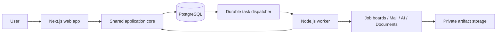

# Jobflow

A self-hosted job-search workspace for discovering opportunities, reviewing visa sponsorship evidence, preparing grounded application documents, and tracking applications from email.

**Status: design phase.** This repository currently contains a proposed architecture and product specification. There is no runnable application, installed dependency set, connected mailbox, active schedule, or released package. Documentation approval does not imply implementation approval.

## What Jobflow is intended to do

Jobflow will connect a verified career profile to a repeatable job-search workflow:

1. Collect opportunities from configured company job boards, manual imports, and supported job-alert emails.
2. Deduplicate listings and preserve the job description used for each analysis.
3. Explain which requirements are supported by the candidate's experience, which are missing, and which need confirmation.
4. Record role-specific visa sponsorship evidence separately from employer-level information.
5. Prepare an editable resume or CV and, optionally, a cover letter using verified career facts.
6. Track application events from a connected mailbox and surface uncertain matches for review.
7. Run discovery on a configurable schedule and show both useful findings and execution failures.

The initial product is for one person running their own instance. Reusable ownership boundaries are included in the design; a hosted multi-tenant service is outside the first release.

## Product principles

- **Evidence before claims.** Recommendations, visa labels, and generated achievements must link back to their inputs.
- **Human review.** Application submission and outbound email are outside the initial scope. The user chooses what to send.
- **Private data stays outside Git.** Career records, mail, tokens, generated documents, database volumes, and backups are runtime data.
- **Portable execution.** Development can happen in Orca or another IDE. The core workflow must not require a Codex subscription, ChatGPT plugin, or a particular hosting vendor.
- **Visible uncertainty.** An unknown sponsorship policy or ambiguous email match is a distinct state, not a negative decision.
- **Recoverable work.** Closing the browser, retrying a job, or restarting a worker must not silently lose work or duplicate application records.

## Proposed architecture

The proposal is an all-TypeScript modular monolith with two processes: a Next.js web application and a durable Node.js worker. They share domain logic and PostgreSQL, but do not call each other to execute business rules.



| Area | Proposed choice | Why it is included |
| --- | --- | --- |
| Web and BFF | Next.js App Router, React, TypeScript | Server-rendered reads, small interactive client components, and server-side mutations in one application |
| Frontend organization | Feature-first modules with thin route files | Keep discovery, career facts, documents, and applications understandable as product capabilities |
| Input contracts | Zod schemas and explicit DTOs | Validate network, form, connector, and model output boundaries without exposing database rows |
| Database | PostgreSQL with Drizzle | Shared transactional records for the web app and durable worker |
| Background work | Independent Node.js worker with pg-boss | Persistent scheduled work, retries, and bounded concurrency using the same database infrastructure |
| Styling | Tailwind CSS and selected shadcn/ui primitives | An owned, accessible component layer with product-specific composition |
| Identity | Single-owner setup; proposed Better Auth session adapter | Authorize private records independently of mailbox OAuth consent |
| Files | Private local data directory initially | Keep source uploads and generated artifacts out of the repository; allow an object-store adapter later |
| Workspace | pnpm workspaces | Share a small number of packages between web and worker |
| Verification | Vitest and Playwright | Test domain rules and real browser workflows at their appropriate boundaries |

PostgreSQL adds a local service to operate, but provides a single storage foundation for application records and durable tasks. The trade-off against SQLite and other queue options is recorded in [ADR 0002](docs/architecture/decisions/0002-durable-worker-postgresql.md).

The working compatibility baseline is the Next.js 16 App Router family, compatible stable React 19 and TypeScript releases, and Node.js 24 LTS. Exact versions, security patches, PostgreSQL compatibility, and dependency licenses must be verified and pinned when scaffolding is approved. This is a design baseline, not an installed-version report. See the [source register](docs/architecture/sources.md).

## Planned capabilities and boundaries

| Capability | First implementation target | Important boundary |
| --- | --- | --- |
| Career profile | Upload/import, extract, review, confirm facts | Extracted text is not a verified career fact until reviewed |
| Job discovery | Manual JD import and one public ATS adapter | An ATS board is company-specific; it is not a global job-search engine |
| LinkedIn discovery | Supported job-alert email intake | No automated login, session-cookie collection, or LinkedIn page scraping |
| JD analysis | Evidence-linked requirements and gaps | No opaque score used as the sole exclusion rule |
| Visa evidence | Supported / not supported / conditional / unknown | Employer sponsorship history does not prove support for an individual opening |
| Documents | Editable structured drafts; PDF and DOCX export | Generated content remains a draft until reviewed; export quality must be verified |
| Cover letters | Optional; factual, concise, voice-aware drafting | No invented motivation, metrics, achievements, or generic praise |
| Mailbox sync | One provider with read-only consent | Provider choice and required scopes remain open |
| Application tracking | Timeline plus user-confirmed corrections | Company name alone is insufficient to match an email to an application |
| Scheduling | Timezone-aware recurring discovery | Local execution requires the host to be running; always-on execution requires an always-on host |

All of these are **planned**, not shipped features. The initial mailbox provider, AI provider/model, target jobs/countries, daily time, and document-generation policy still require user decisions.

## Documentation map

Start with the [documentation guide](docs/README.md), then read:

- [Product requirements](docs/product/requirements.md): scope, decisions, and acceptance criteria.
- [Experience design](docs/product/experience.md): navigation, page layouts, user journeys, and interface states.
- [System architecture](docs/architecture/overview.md): processes, packages, dependency rules, and deployment boundaries.
- [Frontend architecture](docs/architecture/frontend.md): App Router, feature structure, state, forms, and component boundaries.
- [Backend architecture](docs/architecture/backend.md): authorized use cases, Next.js entry points, and durable execution.
- [Data model](docs/architecture/data-model.md): records, relationships, versioning, and lifecycle rules.
- [Workflow design](docs/architecture/workflows.md): collection, analysis, writing, mail sync, and recovery.
- [Privacy and security](docs/architecture/privacy-security.md): private data, identity, external content, and secrets.
- [Implementation plan](docs/planning/implementation-plan.md): review gates and ordered delivery slices.
- [Quality strategy](docs/planning/quality-strategy.md): tests and release evidence.
- [Architecture decisions](docs/architecture/decisions/): choices, alternatives, and consequences.

## Repository layout

Only the README and documentation exist at this stage. The application layout below is proposed:

```text
jobflow/
├── apps/
│   ├── web/                 # Next.js App Router, UI, server entry points
│   └── worker/              # Dispatcher, schedules, queue consumers
├── packages/
│   ├── core/                # Domain rules, application use cases, ports
│   ├── contracts/           # Browser-safe transport schemas and DTOs
│   ├── db/                  # Drizzle schema, repositories, queue adapter
│   └── integrations/        # Job, mail, AI, document, and file adapters
├── docs/                    # Product, architecture, decisions, delivery
├── examples/                # Synthetic examples only
└── tests/                   # Cross-process and browser scenarios
```

## Development and setup status

There are no install, development, migration, or test commands to run yet. A package manifest, lockfile, workspace definition, environment template, and container configuration will be added only after architecture approval.

The intended contributor experience is:

1. Clone the repository and open its root in an IDE.
2. Install the pinned Node.js LTS and pnpm versions documented by the future scaffold.
3. Start a local PostgreSQL instance using the provided container configuration or an existing compatible installation.
4. Choose a private data directory outside the checkout and initialize the owner account and runtime encryption key.
5. Apply committed database migrations and start the web and worker processes.
6. Explore an explicit synthetic demo mode before connecting a real account.
7. Configure only the providers needed for the selected workflow.

The future setup guide must include one documented command for starting the development processes and one container-based self-hosting path. These are acceptance requirements, not available commands.

### Planned configuration categories

| Configuration | Purpose | Handling |
| --- | --- | --- |
| `DATABASE_URL` | PostgreSQL connection | Server and worker only; never included in client bundles |
| `JOBFLOW_DATA_DIR` | Private uploads and artifacts | Absolute path or mounted volume outside the checkout |
| `JOBFLOW_APP_URL` | Canonical application origin | Used for callbacks and origin checks; not an authentication credential |
| `JOBFLOW_ENCRYPTION_KEY` | Encrypt stored integration credentials | Runtime secret supplied outside Git; backup policy must account for it |
| Provider credentials | Mailbox and AI authentication | Names and scopes finalized after provider selection; never `NEXT_PUBLIC_*` |
| Schedule and budgets | Timezone, cadence, limits, generation policy | Owner settings stored in the database; secrets are excluded |

## Contributing and open-source release

During the design phase, contributions should improve requirements, architecture consistency, accessibility, or proposed acceptance criteria. Implementation work starts after the design review gate.

Use synthetic fixtures for examples, screenshots, tests, and issue reports. Do not attach real resumes, mailbox exports, credentials, or generated personal application packages. A later contribution guide will describe code checks, migration review, and pull-request expectations.

**License: pending owner selection.** No license has been chosen by this proposal. License selection, dependency review, a contribution guide, a security-reporting process, and a verified installation walkthrough are required before an open-source release is announced.

## Review before implementation

The next approval concerns the proposed architecture and first implementation slice. It does not enable account access, a schedule, publication, or automatic application submission. See [open decisions](docs/planning/implementation-plan.md#3-decisions-required-before-their-dependent-slice) for the remaining product choices.
