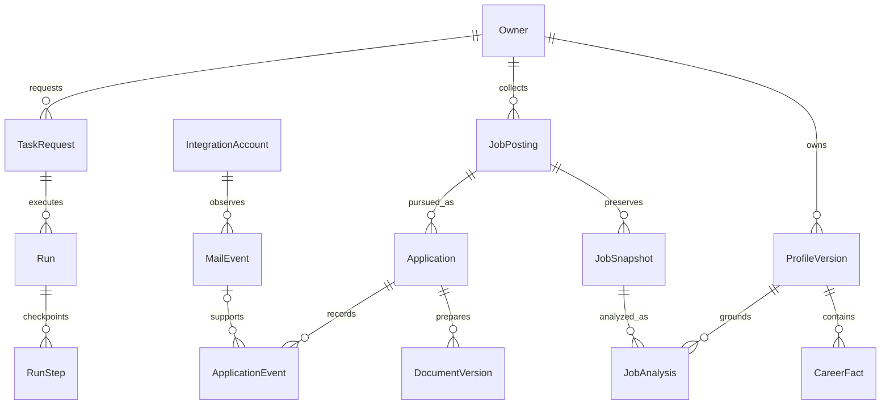

# Data Model

Status: **Proposed — pending implementation approval**  
Design date: **2026-11-05**

This document defines the minimum persistent model for Jobflow. Names describe proposed entities, not existing tables or generated migrations. PostgreSQL is the proposed source of truth; Drizzle owns application schema changes, and pg-boss owns its queue schema. Artifact bytes live outside the Git checkout. See [Backend Architecture](backend.md), [Workflows](workflows.md), and [Privacy and Security](privacy-security.md).

## Ownership and versioning rules

- Every application record belongs to an `Owner`, including records created by unattended runs. Repository methods require an owner principal rather than accepting an unrestricted identifier lookup.
- Use opaque UUIDs, UTC timestamps, and an integer `revision` for mutable aggregates. An update must match the last observed revision; a conflict returns the current version for review rather than overwriting another edit.
- Cross-record references must preserve ownership. Composite foreign keys involving `owner_id` and the referenced ID enforce this where practical; application authorization remains mandatory.
- Separate stable identities from immutable evidence. A posting can change, but the exact JD used to create a document must remain identifiable.
- Never replace a historical document or confirmed fact revision in place. Corrections create a successor and identify what they supersede.

Entity names and TypeScript DTO fields use PascalCase/camelCase in this specification; proposed SQL columns use snake_case. For example, `archivedAt` and `archived_at` denote the same property at different boundaries.

## Entity inventory

| Entity | Minimum information | Important constraint |
| --- | --- | --- |
| `Owner` | ID, display preferences, created/deactivated timestamps | One owner is supported initially; the owner boundary is still explicit. |
| `Profile` / `ProfileVersion` | Current version pointer; versioned contact details, career preferences, uploaded-source artifact IDs, created timestamp | A confirmed version is immutable. Store visa needs as user-provided preferences, not an inferred legal conclusion. |
| `CareerFact` | Profile version, stable fact key, fact revision, text/structured value, source locator, confirmation timestamp, superseded revision | Only user-confirmed facts can support final application documents. Parsing output starts unconfirmed. |
| `JobPosting` | Owner, source/account or board identity, provider posting ID, canonical URL, current snapshot, first/last seen, availability | Unique source identity per owner. Keep availability separate from the user's application stage. |
| `JobSnapshot` | Posting ID, normalized title/company/location/JD, content digest, retrieved timestamp, source URL | Immutable; unique posting plus digest. Changed content creates a snapshot. |
| `JobAnalysis` | Snapshot, profile version, requirements and fact matches, gaps, explanation, model/prompt versions, created timestamp | A new profile or JD marks the old analysis stale; it does not silently rewrite it. |
| `VisaEvidence` | Posting/snapshot or employer scope, assessment, quote, source URL, observed timestamp, country/route if stated | Scope and evidence provenance are required. Employer evidence cannot assert a job-level sponsorship promise. |
| `Application` | Posting, selected snapshot, stage, stage revision, notes, applied timestamp, archived timestamp | Distinct from discovery; different roles at one company remain separate applications. |
| `DocumentVersion` | Application, document kind, editable content artifact, export artifacts, fact references, profile/JD/analysis versions, generation metadata, review state | Append-only versions; provenance cannot be dropped during export. |
| `MailEvent` | Integration account, provider message/thread IDs, event key/type/time, source locator, candidate/matched application, confidence and review state | Unique account plus message ID plus event key. Company name alone is insufficient for a match. |
| `ApplicationEvent` | Application, event type, previous/new stage, actor, reason, optional mail event, recorded/effective timestamps | Append-only history, including explicit corrections and user overrides. |
| `IntegrationAccount` / `SourceCursor` | Provider/account identity, connection state, credential reference; source scope, cursor, last successful checkpoint | Cursor updates commit with the data they acknowledge. Secrets are referenced, not embedded in public DTOs. |
| `TaskRequest` / `Run` / `RunStep` | Owner, operation, idempotency key, payload version; run status/budget; step attempts/checkpoints/errors | Durable request before queue publication; every replay keeps the original logical request identity. |
| `Settings` / `Schedule` | Search preferences, generation policy, budgets; IANA timezone, local schedule, enabled flag, revision | Changes are versioned; a schedule occurrence has a unique logical execution key. |

An `Artifact` record holds an owner, opaque storage key, media type, size, digest, created timestamp, and retention classification. Files are not addressed using user-supplied filesystem paths. Database rows refer to artifact IDs, and an authorized download resolves the storage key server-side.

In the initial route contract, `documentId` identifies one immutable `DocumentVersion`, not a mutable latest-document pointer. Its download endpoint accepts a validated `format=pdf|docx` selector and serves only that version's existing artifact. Regeneration produces a different version ID.

## Logical relationships

The diagram is a logical subset. All private references preserve the owner boundary, and document provenance additionally identifies the exact profile/JD/analysis versions from the inventory above.

## Evidence and visa assessment

`assessment` is one of `supported`, `not_supported`, `conditional`, or `unknown`. An absent sponsorship statement produces `unknown`; it is not negative evidence. Each record states whether the evidence concerns the exact job or only the employer, and whether it was extracted from a job description, employer page, or another identified source.

Snapshot-specific evidence remains attached to that snapshot. A changed role, location, or relevant JD statement requires re-evaluation. The UI must show evidence age and source scope. An employer's past sponsorship or listing in a sponsor register is contextual evidence, not a guarantee for the current role or a determination of the applicant's eligibility.

Requirement matches distinguish `supported`, `missing`, and `unverified`, with fact references and an explanation. A numeric ranking is optional presentation metadata; it cannot erase a failed or unverified requirement.

## Three independent state machines

| Concern | Values | Transition policy |
| --- | --- | --- |
| Application stage | `interested`, `preparing`, `applied`, `assessment`, `interview`, `offer`, `rejected`, `withdrawn` | User commands or accepted evidence create an `ApplicationEvent`. Archive using `archived_at`, not another recruitment stage. |
| Run status | `queued`, `running`, `succeeded`, `partially_succeeded`, `failed`, `cancelled` | Worker transitions are persisted. One provider failing may produce `partially_succeeded` with successful steps retained. |
| Document review | `draft`, `needs_review`, `approved` | Approval identifies an exact document version. Any edit creates a successor requiring review. |

Job availability (`open`, `closed`, `unknown`) and email matching (`unmatched`, `needs_review`, `linked`, `dismissed`) are separate fields. A closed posting does not imply rejection. A successful export does not imply document approval or application submission.

A completed generation run can coexist with a document in `needs_review`. Human review does not leave a queue job or run active indefinitely. Historical approval remains attached to its exact document version; changed inputs mark a package stale for future use, while edits create an unapproved successor.

Email-derived changes are not ordered simply by enum position. Delayed or contradictory messages create a review item. A user correction remains authoritative until the user accepts a later conflicting interpretation. Store the evidence and actor behind each transition rather than reconstructing history from the latest stage.

## Identity, deduplication, and indexes

Prefer provider IDs scoped by connector and board/account. Manual imports receive an internal ID; a normalized URL and content digest can suggest a duplicate but must not merge distinct roles automatically. Tracking parameters may be removed from canonical URLs without discarding source URLs needed for provenance.

Create indexes for owner plus stage/updated time, posting source identity, snapshot digest, application posting, document application/version, email account/message, run owner/status/created time, and pending task publication. Uniqueness belongs in the database as well as in application checks.

Document generation uses a logical key containing owner, application, profile version, JD snapshot, document kind, template/prompt/model configuration, and an explicit regeneration nonce. Retrying one request reuses the result; intentionally regenerating creates a new request/version. Queue delivery is treated as at least once, and external effects need their own idempotency checks.

Persist each imported page and its checkpoint in one transaction. Advance a cursor only after all records covered by it are committed. Provider cursor expiry triggers a bounded resync with the same deduplication rules. A missing listing during one failed or partial scan never closes a posting automatically.

## Lifecycle, deletion, and recovery

Raw uploads and message content are minimized and governed by configurable retention. Keep only the evidence excerpts and provider references needed for application tracking by default; storing full mail bodies must be an explicit choice. Derived search indexes remain owner-scoped and are rebuilt from authoritative records. Embeddings and an external vector database are outside the first version.

Deleting a profile source must identify dependent facts, analyses, and documents. Removing the source bytes may preserve a user-approved fact, but the UI must explain lost provenance. A full owner deletion cancels tasks, revokes or removes local connection credentials, deletes database records and artifacts, and reports separately any third-party retention that Jobflow cannot control.

Backups cover a consistent database snapshot and referenced artifact manifest. Restore verifies digests, ownership, schema version, and missing artifacts before starting workers. Encryption keys require separate protected recovery; a database backup alone cannot restore encrypted provider credentials. Retention applies to backups on their own expiration schedule. Migration and restore drills are part of the release gate, not a claim of implemented support.

## Implementation acceptance checks

1. Owner A cannot read or reference Owner B's records through the API, a Server Action, or a worker request.
2. Replaying a collection or generation request does not duplicate facts, documents, or email events.
3. A JD/profile edit marks dependent analyses and drafts stale without changing historical versions.
4. Delayed email and simultaneous user edits cannot silently overwrite application state.
5. A restore produces a usable application with matching artifact digests and no replay storm.
