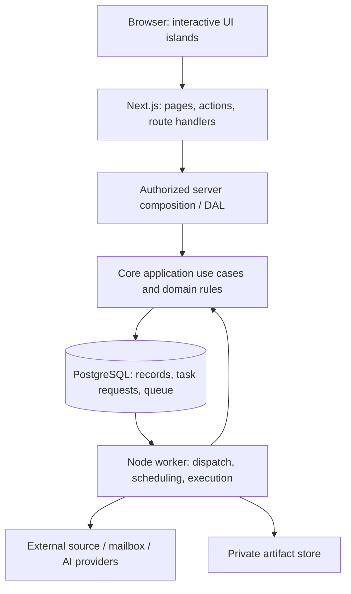

# System architecture

**Status:** Proposed · **Date:** 2026-11-05

## 1. Architectural goals

Jobflow is a self-hosted application for one person's job search. The architecture must support a useful interactive dashboard and repeatable unattended processing while keeping career and mailbox data private. The initial topology is a modular monolith: one repository, shared domain code, one database, a web process, and a worker process.

This proposal uses current App Router conventions, explicit TypeScript contracts, a server-side data access boundary, and durable background execution. Feature-first organization, PostgreSQL, and the queue provider are Jobflow decisions, not rules imposed by Next.js. The [source register](sources.md) separates framework guidance from project choices.

## 2. Runtime topology



The database and external arrows represent adapter calls through ports; the core does not import a database driver or provider SDK. The web and worker composition roots supply those implementations.

The Next.js process serves the UI, resolves identity, validates input, performs short authorized operations, and records durable work requests. The worker performs source collection, model calls, document rendering, scheduled mailbox synchronization, retries, and reconciliation. A submitted request survives browser closure and web-process restart once its database transaction commits.

Next.js Route Handlers provide HTTP boundaries, but deployment environments can limit long request execution. Therefore Jobflow does not use request lifetime, an in-memory timer, or an unawaited promise as a guarantee for scheduled work. [Next.js BFF guidance](https://nextjs.org/docs/app/guides/backend-for-frontend) informs this boundary.

## 3. Package responsibilities

| Package or application | Responsibility | Allowed workspace dependencies |
| --- | --- | --- |
| `packages/core` | Domain policies, state transitions, application commands/queries, ports | None; it is independent of framework, storage, and transport |
| `packages/contracts` | Zod transport schemas, safe DTOs, error codes, serialized task payload contracts | None; no database, framework, or secret access |
| `packages/db` | Drizzle schema/migrations, repositories, transactions, durable-request and queue adapters | `core` |
| `packages/integrations` | Source, mailbox, AI, rendering, and private-file adapters | `core`; optional shared validation from `contracts` where appropriate |
| `apps/web` | Routes, UI features, identity/session adapter, DTO mapping, server composition | `contracts`; server modules may also depend on `core`, `db`, `integrations` |
| `apps/worker` | Task dispatch, schedule reconciliation, adapter composition, process lifecycle | `core`, `contracts`, `db`, `integrations` |

Only process composition roots wire infrastructure to use cases: the web server composition root and the independent worker bootstrap. Client components may import browser-safe contracts and UI code, never database/integration modules or server composition. Server-only web modules use the framework's server-only boundary; package export maps and lint rules enforce the dependency graph. A standalone worker must remain usable without importing Next.js or React.

Domain objects are not automatically transport objects. Map use-case results into allowlisted DTOs before rendering or returning JSON. Credentials, raw mailbox payloads, provider identifiers not needed by a view, and internal database rows do not cross the browser boundary. The server-side DAL performs authorization and data minimization, following [Next.js data security guidance](https://nextjs.org/docs/app/guides/data-security).

## 4. Proposed repository shape

```text
apps/
  web/src/
    app/                         # Route composition and HTTP boundaries
    features/                    # Profile, discovery, applications, documents, inbox, automation, settings
    components/ui/               # Shared visual primitives
    lib/client/                  # Browser-safe utilities
    lib/server/                  # Identity, DAL, dependency composition, response mapping
  worker/src/
    bootstrap/                   # Configuration and adapter composition
    dispatch/                    # Durable request -> queue reconciliation
    schedules/                   # Timezone and missed-run policies
    handlers/                    # Thin task handlers calling core use cases
packages/
  core/src/{domain,application,ports}/
  contracts/src/
  db/src/{schema,repositories,transactions,queue}/
  integrations/src/{sources,mail,ai,documents,files}/
docs/
examples/
tests/
```

This is the intended layout, not a set of existing code directories. The [frontend document](frontend.md) specifies route-local and feature-local organization in more detail.

## 5. Three execution paths

**Read:** authenticated request -> owner-scoped query -> repository -> safe read model -> DTO -> Server Component. The server reads through its DAL directly, without fetching its own Route Handler over HTTP.

**Short mutation:** authorized Server Action -> runtime input validation -> application command -> transaction -> safe result -> affected page refresh. Navigation state and disposable form state do not become database models.

**Long operation:** authorized action/endpoint -> transaction storing task request and inputs -> dispatcher -> durable queue -> worker -> result/event/document persistence -> status query. A separate request/outbox record and a reconciler close the failure window between committing intent and publishing queue work. Application effects remain idempotent under retries.

## 6. Storage and ownership

PostgreSQL is the only initial database dialect. Drizzle migrations are committed and reviewed, and pg-boss owns its internal queue schema. Application migrations do not modify queue internals. Queue versions and database capabilities must be verified together during scaffolding.

Private files live outside the checkout in a configured data directory. Upload bytes, document artifacts, and database metadata are version-linked. A future object-store adapter can replace local files, but a database switch is not described as a configuration-only operation.

Every private record belongs to an owner, directly or through an enforced owner-scoped parent. The first deployment has one owner and closed registration after bootstrap. UI sign-in is distinct from consenting to mailbox access. Worker requests carry a durable owner context and recheck integration availability when they execute.

## 7. Deployment profiles

| Profile | Processes and state | Guarantee and limitation |
| --- | --- | --- |
| Local development | Web, worker, local PostgreSQL, private local files | Interactive work and scheduled runs while the host is available; no guarantee while the Mac sleeps or is off |
| Self-hosted always-on | Web, worker, PostgreSQL, persistent private volumes, authenticated HTTPS entry | Can execute with the user's laptop off, subject to host/provider availability and configured retry policies |
| Web-only serverless hosting | Web app plus separately operated worker, database, artifact storage | Not sufficient on its own for discovery, mail sync, or document generation |

The deployment choice is still pending. The software boundaries support both local and always-on operation; no server has been selected or provisioned. A future container configuration should expose only the web entry point and keep database/worker services private.

## 8. Frontend and data freshness

Server Components own initial page reads. Client components handle forms, dialogs, document editing, comparisons, and active-run polling. Private career, application, and mailbox data has no persistent shared response cache in the baseline. Request-local deduplication is acceptable; it does not replace authorization.

After a mutation, refresh or invalidate the specific affected view. Poll a running task's owner-scoped status endpoint with backoff and stop at terminal states or when the page is hidden. Cache Components and wider query-cache libraries can be introduced only with an explicit ownership/invalidation use case; they are not baseline requirements.

## 9. Deliberate limits

The first release does not include microservices, Redis, a general plugin marketplace, vector search, multi-agent orchestration infrastructure, a hosted SaaS billing model, or automated application submission. New packages or infrastructure require a concrete use case and an ADR. The design leaves external providers replaceable without building every possible provider before the first workflow is useful.

## 10. Approval and implementation boundaries

This document proposes a direction. No application framework, worker, database, integration, or production deployment has been created in the target repository. Approval of the next implementation slice should resolve the gates in the [implementation plan](../planning/implementation-plan.md), rather than treating every future capability as already authorized or operational.
